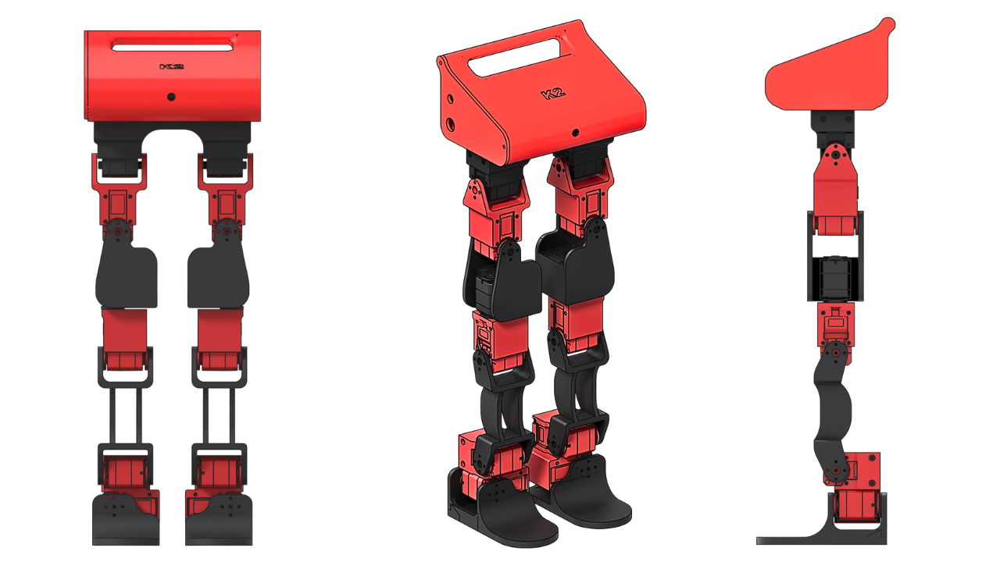

# K2

K2 is an open-source, 3D-printed 12-DOF biped whose learned locomotion loop runs
entirely on a microcontroller. A 55,088-parameter policy, trained with PPO in
MuJoCo, runs at 50 Hz on a Seeed XIAO ESP32-S3. The ESP32-S3 handles IMU
sensing, telemetry from 12 servos, inference and joint commands, with no Linux
computer or GPU on board. The same policy also runs on a Raspberry Pi 5.

One policy covers **hold, march, forward/backward walking, turning and lateral
stepping**. The bill of materials is **$320.52**.



Demo video: <https://youtu.be/8uN9Q3C49-k>

## At a glance

| | |
| --- | --- |
| Mechanism | 12 DOF (hip pitch/roll/yaw, knee, ankle pitch/roll per leg); 0.426 m tall; 1.40 kg |
| Actuators | 12 × Feetech STS3215 position servos on one 1 Mbaud half-duplex bus |
| Controller | Seeed XIAO ESP32-S3 Sense (240 MHz Xtensa LX7); Raspberry Pi 5 also supported |
| Sensing | LSM6DS3 IMU over I²C, plus joint position and velocity from each servo |
| Policy | MLP 50 → 256 → 128 → 64 → 12, ELU, FP32 (215 KiB), 50 Hz |
| Command limits | 0.05 m/s forward/backward, 0.03 m/s lateral, 0.25 rad/s yaw |

**Measured on the robot (ESP32-S3, 50 Hz):**
- **Per-tick timing:** inference takes 6.34 ms, the servo read 4.17 ms, and total
  work 11.98 ms, which uses 59.9% of the 20 ms budget.
- **Deadlines:** none missed in 23,408 logged ticks.
- **Walking quality:** joint tracking error is 1.55° RMS and mean body tilt is
  3.72° while moving.
- **Raspberry Pi 5, same policy:** total work drops to 4.16 ms per tick, with
  similar walking quality and timing regularity.
- **Other rates:** walking holds at 25 Hz but fails at 10 Hz.

## Bill of materials

| Item | Qty | Unit (USD) | Subtotal (USD) |
| --- | ---: | ---: | ---: |
| Feetech STS3215 serial-bus servo | 12 | 19.90 | 238.80 |
| Seeed XIAO ESP32-S3 Sense | 1 | 13.99 | 13.99 |
| LSM6DS3 IMU breakout | 1 | 4.99 | 4.99 |
| Serial-bus servo interface | 1 | 10.50 | 10.50 |
| DC/DC converter | 1 | 7.50 | 7.50 |
| Battery | 1 | 12.66 | 12.66 |
| Wiring | – | 4.20 | 4.20 |
| Switch and connectors | 1 | 7.88 | 7.88 |
| Printed material (approx.) | – | 20.00 | 20.00 |
| **Total** | | | **320.52** |

Prices are the builder's own; shipping, tax and printer time are excluded. The
Raspberry Pi 5 is optional and not included. Printable parts are in `3D-Files/`.

## Repository layout

| Path | Contents |
| --- | --- |
| `esp32-s3/` | Onboard firmware (PlatformIO), web and Xbox BLE control, export tools, native tests |
| `hardware/` | Pi runtime: servo bus, IMU, calibration, servo ID setup, policy runner |
| `k2_rl/` | mjlab tasks, PPO training, evaluation, ONNX export |
| `policies/last_policy.onnx` | Shipped policy (the one embedded in the firmware) |
| `mjcf/`, `meshes/`, `urdf/` | Digital twin generated from the CAD |
| `3D-Files/` | Printable STLs for the 18 structural parts |
| `scripts/` | CAD-to-simulation generation and model validation |
| `site/` | Project website with an interactive joint viewer |

## Try it in simulation

No robot or GPU needed. On Linux with a desktop session:

```bash
git clone https://github.com/kapalikkhanal/K2.git && cd K2
python3 -m venv .venv && source .venv/bin/activate
pip install -r hardware/requirements-pi.txt
python keyboard.py --policy policies/last_policy.onnx
```

Click the MuJoCo window, then use these keys. Commands latch until another key
is pressed.

| Key | Action |
| --- | --- |
| H | Hold (smooth stop) |
| M | March in place |
| W / S | Walk forward / backward |
| A / D | Step left / right |
| Q / E | Turn left / right |
| X | Clear steering |
| Esc | Quit |

Change speeds with `--speed`, `--lateral-speed` and `--yaw-rate`; see
`python keyboard.py --help` for all options. `joystick.py` does the same with an
Xbox controller.

## Run on the robot

**ESP32-S3 (onboard).** Build and flash with PlatformIO by following the
[ESP32 guide](esp32-s3/README.md). Then join the **K2-Robot** Wi-Fi network and
open <http://192.168.4.1>, or use an Xbox controller over BLE. Support the robot
when enabling torque. Torque cuts out above 24° of tilt.

**Raspberry Pi 5.** Use 64-bit Raspberry Pi OS. Enable I²C and the serial port
in `raspi-config` and disable the serial login console. Then:

```bash
sudo apt install -y python3-venv python3-dev python3-tk build-essential libgl1 libglfw3
sudo usermod -aG dialout,i2c,input "$USER"   # log out and back in
pip install -r hardware/requirements-pi.txt
python keyboard.py --bus /dev/ttyAMA0 --policy policies/last_policy.onnx
python joystick.py --bus /dev/ttyAMA0 --policy policies/last_policy.onnx  # pair first: sudo scripts/pair_xbox.sh
```

The launcher asks you to type `go` before enabling torque.

**Calibrate every new build.** The checked-in calibration belongs to the original
K2. Run these first:

```bash
python -m hardware.set_servo_id --port /dev/ttyACM0 --scan
python -m hardware.k2_calibrate
python -m hardware.calibrate_imu_level
```

Read `hardware/k2_conventions.py` before changing servo IDs, signs or joint order.

## Training

Training needs mjlab, RSL-RL, PyTorch, MuJoCo and a CUDA GPU. It runs in two
stages. Stage one trains hold, march, walking and turning. Stage two widens that
policy for lateral stepping:

```bash
python -m k2_rl.train Mjlab-Turn-K2 --env.scene.num-envs 4096 --agent.max-iterations 1000
python -m k2_rl.prepare_lateral --checkpoint logs/rsl_rl/k2_turn_v1/<run>/model_<N>.pt
# then run the lateral training command that prepare_lateral prints
```

The shipped policy took about 70 minutes on one RTX PRO 5000. See
[turn-to-lateral training](docs/turn_lateral_training.md),
[full training](docs/full_training.md) and [frames and transforms](docs/transforms.md)
for evaluation, ONNX export and conventions. To put a new policy on the ESP32,
regenerate its weight header with `esp32-s3/tools/export_policy.py`.

## Limitations

K2 is a research platform. It was tested on one robot, on a dry wooden floor, at
low speeds (at most 0.05 m/s). On a rougher floor with small gravel bumps the
current TPU soles could not keep a steady gait. Sensing is proprioceptive only,
and nothing on board handles perception or planning.

## Acknowledgements

Developed with GPU computing and 3D-printing resources from the North Carolina
State University Department of Biological and Agricultural Engineering. K2 builds
on MuJoCo, mjlab, PyTorch, RSL-RL and ONNX Runtime.

## License

[MIT](LICENSE). Dependencies keep their own licenses.
